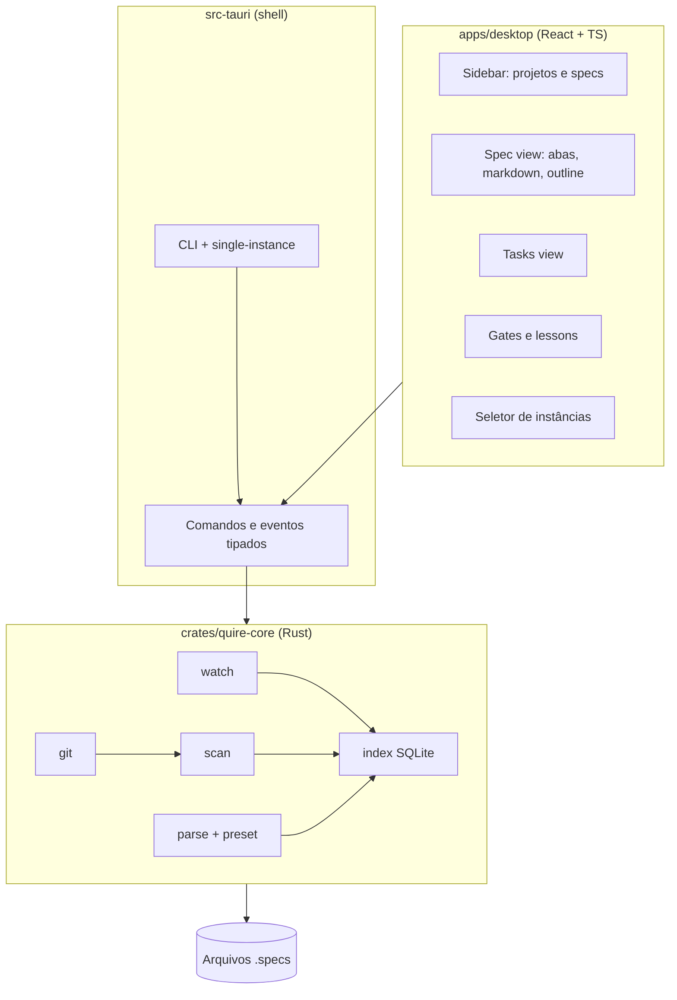

# QUIRE v0.1 — Design

**Idioma:** pt-BR
**Spec:** `spec.md`
**Status:** rascunho, aguardando aprovação do autor

## Abordagens

- **A (escolhida): núcleo em Rust + UI em React dentro do Tauri 2.** O Rust faz scan, git, parsers, índice e watcher (rápido, testável sem UI); o React só renderiza. Prós: leve, bom para I/O e para muitos arquivos, o `quire-core` é reaproveitável. Contras: duas linguagens; WebKitGTK no Linux tem quirks de renderização.
- **B: tudo em TypeScript (Tauri com lógica no frontend).** Menos fronteira de linguagem, mas o scan e o watcher em JS no webview são lentos e pesados em muitos repos.
- **C: Electron.** Mesmo stack de frontend e Chromium previsível, mas o peso (RAM e instalador) contradiz o objetivo de ser leve.

## Architecture Overview



Fluxo principal: o scan e o watcher alimentam o índice; o índice responde às consultas da UI; a UI lê o conteúdo dos arquivos sob demanda. O estado de spec nunca vive fora do disco: o índice é um cache descartável.

## Estrutura do repositório

```
quire/
├─ Cargo.toml                 # workspace: crates/quire-core, apps/desktop/src-tauri
├─ pnpm-workspace.yaml
├─ crates/quire-core/src/{scan,git,model,preset,parse,index,watch,config,error}.rs
├─ apps/desktop/
│  ├─ src-tauri/              # shell: comandos, eventos, CLI, single-instance
│  └─ src/
│     ├─ app/                 # shell React, layout de três colunas, roteamento interno
│     ├─ features/{workspace,spec-view,tasks-view,logs-view,instances}/
│     ├─ lib/{markdown,mermaid,ipc,i18n}/
│     └─ ui/                  # componentes base e tokens (docs/design/tokens.css)
├─ fixtures/workspace/        # projetos sintéticos com worktrees, specs completas e parciais
└─ .specs/features/           # specs do próprio Quire
```

## Components (`quire-core`)

### `scan`
Varre scan paths com a crate `ignore` (respeita `.gitignore`), emite descobertas por canal para a UI progressiva. Entrada: lista de paths. Saída: `Discovery { spec_dir, repo_root }`.

### `git`
Resolve identidade do projeto chamando o `git` do sistema (TD-03): `rev-parse --git-common-dir`, `remote get-url origin`, `worktree list --porcelain`, `rev-parse --abbrev-ref HEAD`. Timeout curto por chamada e cache por repo durante um scan.

### `model`
`Project`, `Spec`, `Instance`, `SpecFile`, `Preset`. Uma `Spec` agrupa `Instance`s; a identidade é `(project_id, folder_name)`.

### `preset`
Define: arquivos primários, parser de cabeçalho, gramática do `tasks.md`, regex de IDs e padrão de chave da issue. Presets embutidos: `generic` e `exban`; carregados de uma struct em Rust, com override por `config.toml`.

### `parse`
Funções puras e tolerantes: `header(md) -> Vec<(key, value)>`, `tasks(md) -> Phases`, `summary_progress(md)`, `ids(md)`, `jsonl<T>(text) -> (Vec<T>, skipped)`. Entrada fora do formato devolve vazio, nunca erro (PST-03).

### `index`
SQLite via `rusqlite` (bundled). Reconciliação incremental por `mtime` e tamanho (IDX-02). Contém também o hash de conteúdo por instância para o dedup.

### `watch`
`notify` com fallback para polling (TD-05). Debounce de 150 ms, agrupa eventos por spec e emite `SpecChanged { project, spec }` e `SpecsListChanged`.

## Shell Tauri (`apps/desktop/src-tauri`)

Comandos (tipos gerados para TS, TD-07):

| Comando | Entrada | Saída |
| --- | --- | --- |
| `get_config` / `set_config` | — / `Config` | `Config` |
| `start_scan` | — | `()` (progresso por evento) |
| `list_projects` | filtros | `Vec<ProjectSummary>` com specs, progresso e `instance_count` |
| `get_spec` | `project_id, folder, instance?` | `SpecDetail` (arquivos, metadados, instâncias) |
| `read_file` | `instance_id, file` | `FileContent` (texto, tamanho, flags) |
| `get_tasks` | `instance_id` | `Phases` parseadas |
| `get_gates` / `get_lessons` | `instance_id` | `(Vec<_>, skipped)` |
| `open_external` | `url` | `()` |

Eventos: `scan://progress`, `specs://changed`, `spec://changed`, `cli://open`.

## Data Models

### SQLite (cache)

```sql
CREATE TABLE projects (id INTEGER PRIMARY KEY, git_common_dir TEXT UNIQUE, name TEXT, preset TEXT);
CREATE TABLE specs (id INTEGER PRIMARY KEY, project_id INTEGER REFERENCES projects(id), folder TEXT, issue_key TEXT,
                    UNIQUE(project_id, folder));
CREATE TABLE instances (id INTEGER PRIMARY KEY, spec_id INTEGER REFERENCES specs(id), path TEXT UNIQUE, branch TEXT,
                        kind TEXT CHECK(kind IN ('worktree','checkout')), mtime INTEGER, content_hash TEXT);
CREATE TABLE files (id INTEGER PRIMARY KEY, instance_id INTEGER REFERENCES instances(id), name TEXT, size INTEGER,
                    mtime INTEGER, UNIQUE(instance_id, name));
```

O progresso, o status e os metadados vivem em colunas derivadas na reconciliação (tabela `spec_meta`), para a lista não abrir arquivos.

### `config.toml`

```toml
scan_paths = ["~/projects"]
poll_interval_ms = 3000

[projects."acme_gateway"]
preset = "exban"
alias = "gateway"
issue_url_base = "https://tracker.example/browse/"
```

## Error Handling Strategy

| Cenário | Comportamento |
| --- | --- |
| Scan path inexistente ou sem permissão | Marca o path com o erro, segue com os demais (DSC-05) |
| `git` ausente ou repo corrompido | Projeto cai para o nome da pasta; aviso no rodapé (A4) |
| Arquivo fora do formato | Fallback para markdown ou texto puro (PST-03) |
| JSONL com linha inválida | Ignora a linha e conta em `skipped` (LOG-04) |
| Mermaid inválido | Mostra o código e a mensagem (VIW-03) |
| Cache corrompido | Apaga e reconstrói (IDX-01) |
| Instância removida durante leitura | Fallback para outra instância (WAT-04) |

## Tech Decisions

- **TD-01 Tauri 2** em vez de Electron: peso e consumo (ver abordagens).
- **TD-02 Monorepo com Cargo workspace + pnpm workspace:** `quire-core` testável sem Tauri; o frontend em `apps/desktop`.
- **TD-03 `git` via processo** em vez de `libgit2`/`gix` na v0.1: evita dependência nativa pesada e cobre `worktree list` e `common-dir`; reavaliar `gix` na v0.3 (histórico por spec).
- **TD-04 Markdown no frontend** com `unified` + `remark-gfm` + `rehype`; realce com `shiki` carregando linguagens sob demanda; Mermaid com import dinâmico.
- **TD-05 Watcher com `notify` e fallback para polling:** o polling é ativado por detecção (caminho em `\\wsl$`, DrvFs/9p) ou por config.
- **TD-06 SQLite como cache descartável**, nunca como fonte da verdade.
- **TD-07 Tipos compartilhados** Rust → TS gerados (`tauri-specta`), sem tipos duplicados à mão.
- **TD-08 Estado do frontend com Zustand;** dados do core consultados por comandos tipados com cache simples.
- **TD-09 Tailwind com variáveis CSS** de `docs/design/tokens.css`; tema por classe na raiz.
- **TD-10 CLI e GUI no mesmo binário** (`tauri-plugin-cli` + `tauri-plugin-single-instance`); `--help` e `--version` respondem sem abrir janela.

## Risks & Concerns

- **WebKitGTK:** renderização e rolagem de documentos grandes e Mermaid podem ser lentos; medir no spike (T2) e, se necessário, virtualizar o render por seção.
- **WSL:** sem eventos de arquivo em montagens do Windows; o polling pode custar CPU em muitos arquivos (T3 mede).
- **CLI no Windows nativo:** binário GUI sem console; pode exigir anexar o console ao pai (P2 da spec).
- **Cache vs disco:** a reconciliação precisa ser idempotente para não mostrar specs fantasmas depois de remoções.

## Confirmado no código e não verificado

Projeto novo: não há código ainda. Não verificados, e nenhum artefato pode afirmar o contrário até o spike (T1–T3): desempenho do WebKitGTK com documentos de 40 KB e Mermaid; entrega de eventos do `notify` em `\\wsl$` e DrvFs; comportamento do `tauri-plugin-cli` com `--help` sem janela no Windows; tamanho do bundle com `shiki` e Mermaid sob demanda.
