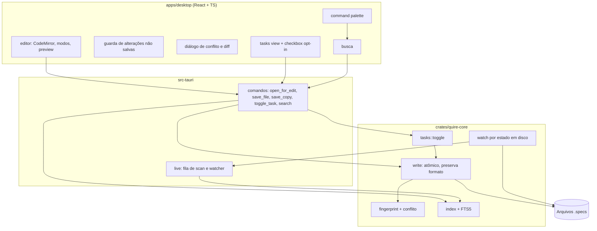

# QUIRE v0.2 — Design

**Idioma:** pt-BR
**Spec:** `spec.md`
**Status:** rascunho, aguardando aprovação do autor

## Ponto de partida (o que a v0.1 entrega e o que muda)

A arquitetura da v0.1 continua (`design.md` da v0.1): o núcleo em Rust (`quire-core`) faz scan, git, parsers, índice e watcher; o shell Tauri expõe comandos tipados; o React só renderiza. A v0.2 acrescenta a **primeira escrita do app em arquivos de spec**, e por isso o caminho de escrita fica inteiro no núcleo, testável sem UI e sem Tauri, como o resto.

Estado herdado que importa para a v0.2 (verificado no código em 2026-11-16, ver "Confirmado no código"):

- O watcher já decide os eventos pelo **estado em disco**, não pelo tipo de evento (correção pós-v0.1, fbbd790): compara tamanho e `mtime` dos arquivos de cada pasta de spec e ignora arquivos ocultos, de backup e temporários (`.x`, `x~`, `*.tmp`, `*.swp`). O temporário da escrita atômica (oculto) é invisível para ele.
- `read_file` devolve o texto UTF-8 como está no disco (BOM e CRLF inclusos), sem impressão digital.
- A única escrita do app hoje é o `config.toml` (`config::save_settings`, com `toml_edit` e escrita por temporário + rename, mas sem fsync nem verificação de conflito).

## Abordagens

### Escrita

- **A (escolhida): pipeline de escrita no núcleo (`quire-core::write`)** com temporário na mesma pasta, fsync, rename e fsync da pasta, mais detecção de conflito por hash do conteúdo bruto. Prós: um único lugar para as garantias de SAV e CNF, testável com tempdir em Linux e Windows (CI), reaproveitado pelo editor, pelo checkbox e pela cópia de conflito. Contras: o núcleo precisa conhecer o formato de texto (EOL, BOM) para codificar o que o editor devolve.
- **B: escrita pelo frontend** (`@tauri-apps/plugin-fs`): menos código em Rust, mas espalha as garantias pela UI, não dá fsync da pasta nem controle de permissões e abre o sistema de arquivos ao webview.
- **C: crate pronta de escrita atômica** (`atomic-write-file`, `tempfile::persist`): resolvem o rename, mas não a preservação de permissões, links simbólicos, a segunda verificação de conflito nem o retry de arquivo em uso no Windows. O pipeline próprio pode usar `tempfile` por baixo só para criar o temporário com nome único.

### Editor

- **A (escolhida): CodeMirror 6** carregado por import dinâmico (TD-11). Leve, modular, acessível, com bom suporte a composição e IME (a confirmar no spike T9 no WebKitGTK).
- **B: Monaco:** pesado (vários MB), pensado para Chromium; sem vantagem para markdown.
- **C: `textarea` com preview:** sem realce, busca nem desfazer confiável; não atende EDT-07.

### Busca

- **A (escolhida): FTS5 no mesmo SQLite do índice** (TD-15). Já compilado no `libsqlite3-sys` embutido; continua cache descartável; reindexa junto com a reconciliação incremental.
- **B: `tantivy`:** mais recursos, mas é um segundo índice para manter em sincronia, com binário maior.
- **C: busca no frontend** (minisearch e afins): exige carregar todo o texto no webview, o que contradiz a meta de memória.

## Architecture Overview



## Estrutura do repositório (o que é novo)

```
crates/quire-core/src/
├─ write.rs        # escrita atômica, formato de texto, permissões, links, retry no Windows
├─ fingerprint.rs  # impressão digital (tamanho, mtime, xxh3-128) e verificação de conflito
├─ tasks_edit.rs   # alternância de checkbox por linha, sobre bytes
└─ search.rs       # esquema FTS5, indexação por seção, consulta segura
apps/desktop/src/
├─ features/editor/      # CodeMirror (lazy), modos, preview, rolagem sincronizada
├─ features/conflict/    # diálogo, diff (@codemirror/merge, lazy), aviso "mudou no disco"
├─ features/unsaved/     # guarda de navegação e de fechamento
├─ features/search/      # painel de resultados, filtros
├─ features/palette/     # Ctrl+K, casamento aproximado, comandos
└─ lib/i18n/en.ts        # catálogo em inglês (DEB-01)
```

## Components

### `quire-core::fingerprint`

`Fingerprint { len: u64, mtime_ns: Option<i128>, hash: u128 }` calculada sobre os **bytes brutos** do arquivo (xxh3-128, a mesma família usada no dedup da v0.1). Igualdade é por `hash` e `len`. O `mtime` serve só de atalho para pular a leitura quando tamanho e `mtime` são iguais aos de uma impressão recente da mesma sessão (A3). `fn of(path) -> Result<Option<Fingerprint>>`, em que `None` significa que o arquivo não existe.

### `quire-core::write`

```
TextFormat { bom: bool, eol: Eol (Lf | Crlf), mixed: bool, final_newline: bool }
fn decode(bytes) -> Result<(String, TextFormat), NotEditable>    // tira o BOM, CRLF → LF, recusa não UTF-8
fn encode(text, &TextFormat) -> Vec<u8>                          // LF → eol, recoloca BOM
fn save(target: &Path, bytes: &[u8], base: Option<&Fingerprint>, opts) -> Result<Fingerprint, WriteError>
```

Passos de `save` (SAV-01 a SAV-05, SAV-08, CNF-03):

1. Resolve o alvo. Se `symlink_metadata` diz que é link, segue até o destino (`canonicalize`); link quebrado → `WriteError::BrokenLink`. A partir daqui tudo acontece na pasta do **destino**.
2. Lê os metadados do destino: somente leitura, ou dono diferente do usuário atual no Unix (`uid`) → `WriteError::ReadOnly` / `ForeignOwner`.
3. **Primeira verificação:** `fingerprint::of(destino)` ≠ `base` → `WriteError::Conflict { disk: Option<Fingerprint> }`. `base = None` significa "o arquivo não deve existir" (cópia de conflito, recriação confirmada); se existir, é conflito.
4. Cria o temporário `.<nome>.quire-<pid>-<contador>.tmp` na mesma pasta com `create_new`. O nome oculto o mantém fora do watcher e da aba "outros" (SAV-10).
5. Escreve os bytes, aplica as permissões do original (modo no Unix, somente leitura no Windows) e faz `sync_all`.
6. **Segunda verificação:** recalcula a impressão do destino. Se mudou, apaga o temporário e devolve `Conflict`.
7. Faz o `rename(tmp, destino)`. No Windows, um erro de compartilhamento (`ERROR_SHARING_VIOLATION`, `ERROR_ACCESS_DENIED` com o arquivo aberto) tenta de novo com espera crescente até 1 s (SAV-08).
8. No Unix, abre a pasta e faz `sync_all` (durabilidade do rename). No Windows não há equivalente sem FFI; o NTFS registra o rename no journal.
9. Devolve a impressão digital nova, calculada dos bytes escritos (sem reler o disco), para a UI usar como nova base.

Qualquer erro entre os passos 4 e 7 remove o temporário criado nessa ação, que é parte da mesma ação explícita (SAV-02). O pipeline nunca escreve no original diretamente, nem como fallback.

**Janela residual (A6, CNF-03):** entre a segunda verificação (passo 6) e o rename (passo 7) há microssegundos em que um agente pode escrever, e essa escrita seria substituída. Sem uma trava respeitada pelos dois lados, não dá para fechar essa janela. O design a reduz ao mínimo, pois os dois passos são consecutivos e sem I/O de rede, e a documenta no README (OSS-05).

### `quire-core::tasks_edit`

`fn toggle(bytes, line: usize, task_id, expected_done: bool) -> Result<Vec<u8>, ToggleError>`:

- Localiza a linha `line` nos bytes, contando LF; o CR, se houver, fica onde está.
- Exige que a linha case com a gramática de tarefa do `parse::tasks` (o mesmo regex), com o mesmo id e o estado esperado; senão devolve `ToggleError::Moved`.
- Troca só o byte entre os colchetes: `' '` → `'x'`, ou `'x'`/`'X'` → `' '`. Todo o resto do vetor fica idêntico (CHK-02); um teste compara byte a byte com e sem CRLF, BOM e newline final.
- A gravação usa `write::save` com `base` = impressão digital do `tasks.md` quando a aba foi carregada (CHK-03).

Linhas dentro de blocos de código nunca chegam aqui, porque o parser não as reconhece como tarefa e a UI não as torna clicáveis.

### `quire-core::search` (FTS5)

Esquema no mesmo banco do índice, com `user_version` 2. Um índice com versão 1 é apagado e reconstruído, como a v0.1 já faz com versões desconhecidas (IDX-01):

```sql
-- conteúdo único por hash: cópias idênticas em várias worktrees são indexadas uma vez (SRC-04)
CREATE TABLE fts_docs (id INTEGER PRIMARY KEY, content_hash TEXT UNIQUE NOT NULL);
CREATE TABLE file_docs (instance_id INTEGER NOT NULL REFERENCES instances(id) ON DELETE CASCADE,
                        name TEXT NOT NULL, doc_id INTEGER NOT NULL REFERENCES fts_docs(id),
                        PRIMARY KEY (instance_id, name));
-- uma linha por seção (título + corpo até o próximo título), para levar o resultado à seção (SRC-06)
CREATE VIRTUAL TABLE fts USING fts5(heading, body, doc_id UNINDEXED, line UNINDEXED,
                                    tokenize = 'unicode61 remove_diacritics 2');
```

- **Indexação:** na reconciliação, um `.md` novo ou alterado (IDX-02) tem o hash calculado. Se o `content_hash` já existe em `fts_docs`, só liga `file_docs`; senão, divide o texto em seções (títulos fora de blocos de código, reaproveitando o parser de outline) e insere as linhas no `fts`. Documentos sem nenhum `file_docs` são removidos ao fim da reconciliação.
- **Consulta (TD-16):** o texto do usuário vira termos separados por espaço. Cada termo é escapado como string do FTS5 (`"…"`, com aspas internas dobradas) e o último ganha `*` (prefixo); os termos são unidos por espaço, que é E implícito. Nenhuma sintaxe do usuário chega crua ao `MATCH` (SRC-07). Filtros (projeto, nome do arquivo, spec atual) são `JOIN`s em `file_docs` → `instances` → `specs` → `projects`. A ordenação é por `bm25(fts, 5.0, 1.0)`, com peso maior para o título da seção. O trecho vem de `snippet(fts, 1, char(2), char(3), '…', 12)`; os marcadores `\u0002`/`\u0003` viram `<mark>` no React, nunca HTML vindo do banco. O limite é de 200 resultados.
- **Agrupamento:** por spec. A instância mostrada é a padrão quando o trecho está nela; senão, a primeira que contém o documento.

### Frontend

- **`features/editor`:** `EditorPane` monta o CodeMirror por import dinâmico (`@codemirror/view`, `state`, `commands`, `search`, `lang-markdown`, `language`), com tema derivado dos tokens CSS. O buffer guarda `{ text, base: Fingerprint, format: TextFormat, dirty }`. O preview reaproveita o pipeline `lib/markdown` da v0.1, com debounce de 200 ms. Para evitar reprocessar diagramas a cada tecla, os blocos Mermaid e Shiki ficam em cache pela origem.
- **Rolagem sincronizada (EDT-04):** o pipeline anota cada bloco de nível superior com `data-line` (a posição do `remark`). Os dois lados mapeiam a linha visível ↔ o bloco mais próximo, com interpolação dentro do bloco; um lado só segue o outro enquanto o usuário rola o primeiro, para não haver ecos.
- **`features/unsaved`:** um store com o arquivo sujo e um `guard(next: () => void)` usado por toda navegação: abas, sidebar, seletor de instância, palette, `cli://open` e preferências. O fechamento da janela usa o `onCloseRequested` do Tauri (`preventDefault` e o diálogo); depois de Salvar ou Descartar, a janela fecha.
- **`features/conflict`:** o diálogo com as quatro ações e o diff por linha com `@codemirror/merge` (unified, carregado sob demanda e reaproveitando o CodeMirror já baixado). O aviso fixo de CNF-05 fica acima do editor.
- **Supressão da própria escrita (TD-14):** depois de `save_file`, a UI troca a `base` pela impressão digital devolvida. Ao receber `spec://changed`, pede `file_fingerprint` e compara: se for igual à `base`, ignora (CNF-06); se diferir e o buffer estiver limpo, recarrega (CNF-04); se diferir e o buffer estiver sujo, mostra o aviso (CNF-05). Não existe janela de tempo do tipo "ignorar eventos por N ms", que esconderia a escrita de um agente feita logo depois do save.
- **`features/search` e `features/palette`:** a palette é um `dialog` com `input` (`role="combobox"`) e `listbox`, e casamento por subsequência feito em casa (TD-17). Os resultados full-text vêm de `search` (backend), com debounce de 120 ms.
- **Checkbox (CHK):** na aba tasks, quando o projeto tem `tasks_checkbox = true`, o ícone de estado vira um `input type="checkbox"` real com rótulo. O clique chama `toggle_task` com a impressão do `tasks.md` carregado.

## Shell Tauri: comandos e eventos novos

| Comando | Entrada | Saída |
| --- | --- | --- |
| `open_for_edit` | `instance_id, name` | `EditableFile { text, format, fingerprint, editable: Result<(), Motivo> }` |
| `file_fingerprint` | `instance_id, name` | `Option<Fingerprint>` |
| `save_file` | `instance_id, name, text, format, base, confirm_mixed_eol, allow_recreate` | `Saved { fingerprint }` ou `Conflict { disk_text?, fingerprint? }`, `ReadOnly`, `InUse`… (códigos, DEB-02) |
| `save_copy` | `instance_id, name, text, format` | `Saved { name_da_copia, fingerprint }` |
| `toggle_task` | `instance_id, task_id, line, expected_done, base` | `Toggled { fingerprint, tasks }` ou `Conflict`/`Moved` |
| `search` | `query, filtros, limite` | `Vec<SearchHit>` agrupados |
| `orphan_temps` / `remove_orphan_temp` | `instance_id` / `instance_id, name` | lista / `()` (SAV-10, só por clique) |

Todos validam o nome como na `read_known` da v0.1 (um componente só, arquivo listado na instância) e, para escrita, a extensão `.md` e a exclusão dos JSONL (SAV-09). Depois de uma escrita bem-sucedida, o shell chama `live::request_scan` com a pasta da spec, para o índice, a lista e o FTS se atualizarem sem esperar o watcher (PRG-01, INS-03). O `toggle_task` já devolve o `TasksView` novo para a UI atualizar o progresso na hora.

Eventos: nenhum novo. `spec://changed` (v0.1) passa a ser tratado pela regra do TD-14.

## Data Models

### `config.toml`

```toml
language = "pt-BR"            # novo (DEB-01); "pt-BR" | "en"; ausente = idioma do sistema (A9)

[projects."acme_gateway"]
preset = "exban"
tasks_checkbox = true         # novo (CHK-01); padrão false
```

`ProjectConfig` usa `deny_unknown_fields`. Os campos novos entram no `struct`, no `save_settings` (que preserva comentários) e na tela de Preferências. Um `config.toml` da v0.2 lido por uma v0.1 dá erro de campo desconhecido, que a v0.1 já mostra sem sobrescrever o arquivo.

### Índice

`user_version` 2 com as tabelas de busca acima. As tabelas da v0.1 não mudam.

## Error Handling Strategy

| Cenário | Comportamento |
| --- | --- |
| Conteúdo no disco ≠ base no save | Não escreve; diálogo de conflito (CNF-02) |
| Mudança entre a 2ª verificação e o rename | Não detectável (A6); documentado |
| Arquivo somente leitura ou de outro dono | Não escreve; oferece cópia (SAV-04) |
| Pasta sem permissão, disco cheio, I/O | Original intacto, temporário removido, buffer mantido, motivo exibido (SAV-02) |
| Arquivo em uso (Windows) | Nova tentativa até 1 s; depois erro "arquivo em uso" (SAV-08) |
| Link simbólico quebrado | Edição desabilitada (EDT-08) |
| Fins de linha mistos | Aviso e confirmação no primeiro save (SAV-03) |
| Não UTF-8, binário, acima do limite | Edição desabilitada (EDT-08) |
| Temporário órfão | Não listado; aviso com remoção por clique (SAV-10) |
| Linha da tarefa mudou | Não escreve; recarrega a aba (CHK-03) |
| Consulta inválida para o FTS | Impossível por construção (TD-16); erro do SQLite vira "nenhum resultado" e log |
| `QUIRE_CONFIG`/`QUIRE_INDEX` relativos, ou índice dentro de `.specs` | Recusa com mensagem; config fica não editável (DEB-05) |

## Tech Decisions

As decisões TD-01 a TD-10 da v0.1 continuam valendo. As novas:

- **TD-11 CodeMirror 6 por import dinâmico** como editor (ver Abordagens). O módulo do editor e o `@codemirror/merge` ficam fora do chunk inicial (EDT-02). O orçamento de bundle sai do spike T9.
- **TD-12 Pipeline de escrita no núcleo** (`write::save`): temporário oculto na mesma pasta, fsync do arquivo, duas verificações de conflito, rename, fsync da pasta no Unix, retry de compartilhamento no Windows. Nunca há escrita direta no original. Preserva BOM, EOL, newline final e permissões; segue links simbólicos até o destino.
- **TD-13 Conflito por hash do conteúdo bruto** (xxh3-128), e não por `mtime`. O `mtime` tem granularidade de até 2 s em FAT/exFAT e é preservado por algumas ferramentas, então não prova nada sozinho (A3).
- **TD-14 Supressão da própria escrita por comparação de impressão digital, não por tempo.** O watcher não muda: ele continua relatando a escrita do app (o índice precisa dela), e a UI descarta o evento quando o disco é igual à `base` nova. Isso também impede um ciclo de recarga (risco "loop de watcher"): nenhuma recarga escreve.
- **TD-15 FTS5 no índice SQLite existente**, com `unicode61 remove_diacritics 2`, uma linha por seção e documentos deduplicados por hash. O cache continua descartável (TD-06).
- **TD-16 Consulta construída, nunca repassada:** os termos do usuário são sempre escapados como strings do FTS5, com prefixo só no último.
- **TD-17 Casamento aproximado da palette feito em casa** (subsequência com bônus para início de palavra e para a chave da issue), com testes, em vez de uma dependência para algumas dezenas de linhas.
- **TD-18 Alternância do checkbox sobre bytes no núcleo**, com a gramática do `parse::tasks` e a escrita do TD-12. A UI nunca reescreve o `tasks.md` inteiro para marcar uma tarefa.
- **TD-19 Catálogo `en` tipado pelo `pt-BR`** (`typeof ptBR` como contrato) e erros do backend como códigos (`CmdError.code`) traduzidos na UI (DEB-01, DEB-02). O idioma é trocado em tempo de execução, sem reiniciar.
- **TD-20 Console do CLI no Windows (DEB-06, P2):** o `unsafe_code = forbid` do workspace impede chamar `AttachConsole` direto no nosso código. Há duas opções, a decidir na T5 conforme P9: (a) um binário de console mínimo (`quire-cli.exe` como sidecar do Tauri, ou `quire.com` ao lado do `quire.exe`, que o `cmd` prefere pela ordem do `PATHEXT`), que responde `--help`/`--version` e repassa o resto ao app; ou (b) uma dependência mantida que encapsula `AttachConsole` (o `unsafe` fica na dependência). A recomendação é (a), porque não depende de FFI e funciona igual em `cmd` e PowerShell.
- **TD-21 Variáveis de ambiente de caminho só absolutas:** `QUIRE_CONFIG` e `QUIRE_INDEX` relativos são recusados, porque o diretório de trabalho do processo varia (`tauri dev` roda em `src-tauri`, o que já gerou um `config.toml` perdido na v0.1). O índice dentro de uma pasta observada também é recusado.

## Risks & Concerns

| Risco | Impacto | Mitigação | Verificação |
| --- | --- | --- | --- |
| **Perda de dados** (save trunca, corrompe ou sobrescreve) | Crítico | TD-12 (nunca escreve no original; temporário + fsync + rename); SAV-02; CNF | Testes de perda de dados na T12: falha injetada em cada etapa, conteúdo do original conferido; roteiro E2E na T26 |
| **Edição concorrente com agente** | Crítico | Duas verificações por hash (TD-13); aviso de mudança no disco com buffer sujo (CNF-05); diff antes de sobrescrever | Testes que escrevem por fora entre as etapas; janela residual documentada (A6) |
| **Loop de watcher** (o save do app dispara recarga, que dispara outro save) | Alto | Nenhum caminho de recarga escreve (SAV-07); supressão por impressão digital (TD-14); o temporário é oculto e ignorado pelo watcher | Teste do shell: save → nenhuma recarga nem aviso em 3 s, uma única reconciliação |
| **CRLF/BOM/newline final** | Alto (diff ruidoso no git, agentes confusos) | `TextFormat` detectado na leitura e reaplicado na escrita; mistos com confirmação | Matriz de testes com as combinações; `.gitattributes` da v0.1 força LF no repositório, então as fixtures de CRLF são geradas pelo script |
| **Links simbólicos** | Alto (trocar o link por arquivo quebra o repo) | Escrever no destino (passo 1 do `save`) | Testes com link para arquivo e para pasta (Unix; no Windows, só se o runner permitir criar links) |
| **Permissões** | Médio | Copiar o modo; recusar somente leitura e dono diferente | Testes Unix de modo 0644/0600/0755; somente leitura no Windows |
| **Arquivo grande** | Médio (editor lento, memória) | Limite de edição (A8) medido no spike T9; preview com debounce e cache de diagramas | Spike T9 e medição de memória (T6, T26) |
| **Escrita em `\\wsl$`, DrvFs, 9p** | Alto (rename pode não ser atômico, eventos não chegam) | Spike T11; até a decisão de P6, edição somente leitura nesses caminhos; o conflito por hash não depende de eventos | Spike T11 (parte em CI no NTFS; WSL com o autor) |
| **Arquivo aberto por outro processo no Windows** | Médio | Nova tentativa por até 1 s (SAV-08) | Teste no CI do Windows segurando o arquivo aberto sem `FILE_SHARE_DELETE` |
| **Teclas mortas e IME no WebKitGTK/Wayland** | Alto para pt-BR | Spike T9 antes de qualquer feature; plano B é o modo Ler e o editor externo, o que adiaria EDT | Spike T9 com roteiro manual do autor |
| **Bundle e memória** | Médio | Editor e merge carregados sob demanda; orçamento medido (DEB-07) | T6, T9, T26 |
| **Crescimento do índice FTS** | Baixo | Deduplicação por hash e cache descartável | Spike T10 |

## Confirmado no código e não verificado

**Confirmado no código (2026-11-16, branch `docs/v0-2-spec` a partir de `feat/core-and-ipc`):**

- `libsqlite3-sys` 0.40.0 (via `rusqlite` 0.42 `bundled`) compila o SQLite com `-DSQLITE_ENABLE_FTS5`: o FTS5 está disponível sem dependência nova.
- `read_file` (`apps/desktop/src-tauri/src/commands.rs`) devolve `String::from_utf8` dos bytes, com BOM e CRLF preservados, sem impressão digital; `LARGE_FILE_BYTES` = 2 MB.
- `read_known` aceita só nomes de um componente que estejam na lista de arquivos da instância (base para a validação de escrita, SAV-09).
- A aba "outros" lista todos os arquivos da pasta, inclusive ocultos, pois o `scan::list_files` não filtra. O temporário órfão precisa ser filtrado explicitamente (SAV-10).
- O watcher ignora nomes ocultos e de backup (`watch::transient`), então o temporário oculto do TD-12 não gera evento por si; o rename para o nome final gera.
- `ProjectConfig` tem `deny_unknown_fields` e só `preset`, `alias` e `issue_url_base`; o `Config` não tem `language`.
- `suggested_preset` existe no índice e no IPC (`ProjectSummary.suggestedPreset`), mas nenhum componente da UI o usa (DEB-03).
- `parse::summary_progress` existe e só é usado em testes (PRG-02).
- `tauri-specta` =2.0.0-rc.29 e `specta` =2.0.0-rc.28 continuam fixados (DEB-08).
- Os wireframes não cobrem o modo editar/dividir nem a palette (`docs/design/README.md`, "Fora do wireframe v1").

**Não verificado (e nenhum artefato pode afirmar o contrário até os spikes):**

- Comportamento do CodeMirror 6 no WebKitGTK sob Wayland com teclas mortas (´ ~ ^ \` ¨), composição e IME (ibus, fcitx5); idem no WebView2 do Windows.
- Latência de digitação e memória do CodeMirror com arquivos de 40 KB, 500 KB e 2 MB.
- Tamanho do índice FTS5 e latência de consulta com ~300 specs.
- Atomicidade do `rename` por cima de arquivo existente em DrvFs (`/mnt/c`), em 9p (WSL acessando o Windows e o Windows acessando o WSL via `\\wsl$`) e no NTFS com o arquivo aberto por outro processo.
- Se o `std::fs::rename` do Windows (`MoveFileExW` com `MOVEFILE_REPLACE_EXISTING`) preserva o atributo somente leitura e as ACLs do original. A hipótese é que não, e por isso o passo 5 reaplica o atributo; as ACLs ficam como risco.
- Preservação de `owner`/`group` no Unix quando o usuário é dono do arquivo, mas não da pasta.
