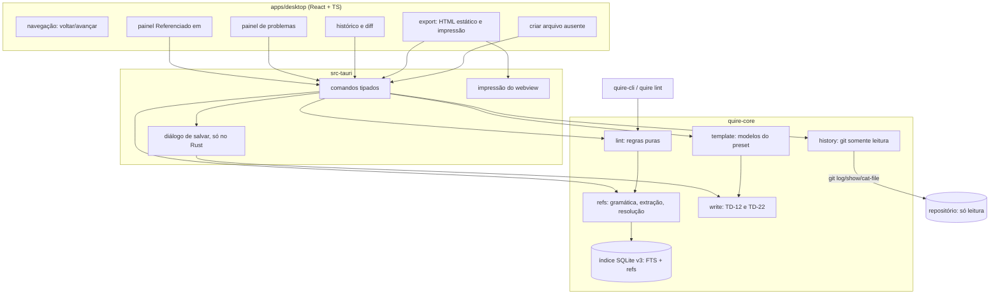

# QUIRE v0.3 — Design

**Idioma:** pt-BR
**Spec:** `spec.md`
**Status:** aprovado com as decisões do autor de 2026-11-16 (Q1–Q10); execução aguardando o feedback de uso da `v0.2.0-rc.1` (Q10)

## Decisões do autor e onde entram no design

As perguntas Q1 a Q10 foram decididas em 2026-11-16 (spec, "Decisões do autor"). Mapeamento:

| Decisão | Onde entra |
| --- | --- |
| Q1: sem ID qualificado entre specs | TD-26 (escopo de resolução) |
| Q2: silenciar só por configuração | TD-29, "Configuração do lint" |
| Q3: `quire-cli` publicado para Linux | TD-30, TD-38, "Binário avulso para CI" |
| Q4: criar spec nova na v0.4 | TD-36, NEW-03 |
| Q5: sem export de JSONL | TD-33, EXP-08 |
| Q6: MSI sem assinatura, SmartScreen documentado | TD-37 |
| Q7: WSL não bloqueia | `tasks.md`, condição 2 |
| Q8: definição de `AD-xxx` em título, item de lista ou linha de tabela | `refs`, gramática `decision`; REF-11 |
| Q9: em paralelo com a v0.2, a partir da `main` atualizada | base do `tasks.md` |
| Q10: aprovada, execução depois do uso da rc.1 | `summary.md` ("Feedback de uso"); `tasks.md`, condição 1 |

## Ponto de partida (o que a v0.2 entrega e o que muda)

A arquitetura continua a das versões anteriores: o núcleo em Rust (`quire-core`) faz scan, git, parsers, índice, escrita e watcher; o shell Tauri expõe comandos tipados; o React só renderiza. A v0.3 acrescenta quatro capacidades de leitura (referências, lint, histórico, export) e uma escrita nova e pequena (criar arquivo ausente). Todas as regras de escrita da v0.2 continuam: o export e a criação passam pelo pipeline do TD-12 e pela classe de sistema de arquivos do TD-22.

Estado herdado que importa (verificado no código em 2026-11-16, ver "Confirmado no código"):

- `parse::ids` já extrai IDs de comentários HTML fora de blocos de código, com linha, e `ids_in_text` acha IDs em texto livre. `parse::tasks` já guarda `requirements` de cada tarefa (TSK-03).
- `parse::summary_progress` existe e só é usado em testes: é a base da regra `progress-mismatch` (PRG-02).
- O `Preset` tem `id_pattern` e `issue_key_pattern`, ambos sobrescrevíveis no `config.toml` (`[presets.<nome>]`). Não há gramática para `AD-xxx`, `arquivo:linha` nem links relativos.
- `git.rs` chama o `git` do sistema por `Command` com tempo limite (padrão 5 s) e já trata o `git` ausente (teste com binário inexistente). Só roda `rev-parse`, `remote get-url` e `worktree list`.
- O índice tem esquema versionado por `user_version` (v2 com FTS5, documentos deduplicados por hash do conteúdo).
- O modo Ler renderiza por `unified` → `remark-parse` → `remark-gfm` → `remark-rehype`, sem `rehype-raw`: HTML cru do markdown não é renderizado. O Mermaid roda com `securityLevel: "strict"` e cache por fonte e tema. O realce é do Shiki com temas como variáveis CSS.
- Links no modo Ler: só `http(s)` abre (no navegador, pelo `opener`); os demais não navegam (`openLink` em `Markdown.tsx`).
- O diff por linha do conflito mora em `features/conflict/diff.ts`.
- A escrita exclusiva (`create_new_name`: `hard_link`, ou `create_new` como fallback) já existe em `write.rs` e é usada pela cópia de conflito.
- Não há plugin de diálogo de arquivos no shell (`tauri-plugin-dialog` ausente) nem uso de impressão.

## Abordagens

### Referências

- **A (escolhida): extração no núcleo por gramática do preset, ocorrências no índice, resolução na consulta** (TD-25 a TD-27). Prós: o mesmo código serve o painel, o lint e o CLI; a resolução na consulta não fica velha quando um arquivo some ou uma instância muda; o cache continua descartável. Contras: cada consulta faz o join de escopo (medido no spike T5).
- **B: resolver na indexação e guardar o destino.** Consulta trivial, mas cada mudança de arquivo invalida destinos em outras specs, e a deduplicação por hash deixa de valer (o destino depende da instância).
- **C: tudo no frontend, por regex sobre o texto carregado.** Não enxerga specs não abertas, então "Referenciado em" entre specs fica impossível.

### Lint

- **A (escolhida): regras puras no núcleo sobre a spec lida do disco, sem índice** (TD-29). Prós: o mesmo motor roda no app e no `quire lint` de um CI sem cache; testável com tempdir. Contras: o app relê os arquivos da spec a cada mudança (barato, medido no spike T8).
- **B: lint como consultas SQL sobre o índice.** Rápido no app, mas o CLI precisaria construir um índice para rodar, e a regra ficaria acoplada ao esquema.

### Histórico

- **A (escolhida): `git` do sistema, somente leitura, lista fechada de subcomandos, conteúdo por `git show`/`cat-file` e diff no app** (TD-31, TD-32). Prós: nenhuma dependência nova, o mesmo `git` que o usuário confia, e o diff tem a mesma cara em conflito, histórico e instâncias. Contras: processo por chamada (latência; spike T6) e superfície de configuração do repositório (endurecida no TD-31).
- **B: `gix` (gitoxide) ou `git2`.** Sem processo, mas `git2` traz `libgit2` em C, e o `gix` é uma dependência grande com API ainda mudando. A v0.1 escolheu o `git` do sistema (TD-03); trocar agora seria mudança de decisão sem dado que a justifique.

### Export

- **A (escolhida): HTML estático gerado no frontend a partir da mesma árvore do modo Ler; escrita no backend com o diálogo aberto pelo backend; PDF pela impressão do webview** (TD-33, TD-34). Prós: o export mostra exatamente o que o app mostra (mesmo GFM, mesmo realce, mesmos diagramas); o webview não ganha permissão de escrever em caminho arbitrário. Contras: a paginação do PDF depende do motor de cada sistema (WebKitGTK × WebView2), o que o spike T7 mede.
- **B: gerar PDF no Rust** (`printpdf`, `typst`). Exigiria um segundo renderizador de markdown, Mermaid e realce, com resultado diferente do app.
- **C: Chromium headless.** Dependência enorme e rede para baixar; fora de questão.

### Criar arquivo

- **A (escolhida): só arquivos `.md` primários ausentes, com modelo do preset e criação exclusiva** (TD-36). É o mínimo que resolve o caso do `validation.md` e não exige decidir nome de pasta, repositório nem branch (Q4).

## Architecture Overview



## Estrutura do repositório (o que é novo)

```
crates/quire-core/src/
  refs.rs            # gramática por preset, extração de ocorrências, resolução por escopo
  lint/              # motor e uma função por regra; config de severidades
    mod.rs  rules.rs  config.rs
  history.rs         # git somente leitura: log, show, cat-file, diff-tree; endurecimento
  template.rs        # modelos de arquivo por preset
crates/quire-cli/src/
  lib.rs             # já existe: parser clap a partir do plugins.cli; passa a ser usado também pelo app (TD-30)
  lint.rs            # saída texto/JSON e códigos de saída
apps/desktop/src/features/
  navigation/        # pilha de voltar/avançar (TD-28)
  references/        # links no Ler, Referenciado em, cadeia até a evidência
  problems/          # painel de problemas e selos
  history/           # lista de commits, arquivo no commit, diff, commit
  export/            # HTML estático, verificação de vazamento, impressão
apps/desktop/src/lib/diff/   # diff por linha compartilhado (TD-32), saído de features/conflict
apps/desktop/src/assets/fonts/  # Inter e JetBrains Mono woff2 + OFL (DEB-13)
.github/workflows/release.yml   # job do quire-cli avulso para Linux (T24, TD-38)
fixtures/templates/acme_gateway/.specs/STATE.md  # AD-xxx nos três casos de definição (T25)
fixtures/templates/          # specs com referências, STATE.md e defeitos plantados (T22)
```

## Components

### `quire-core::refs` (REF)

- **Gramática (TD-25):** o `Preset` ganha `references: ReferenceGrammar` com quatro entradas opcionais: `requirement` (o `id_pattern` atual, sem mudar o nome no `config.toml`), `issue_key` (o `issue_key_pattern` aplicado ao texto, sem a âncora `^…-` do nome da pasta), `decision` (padrão do `exban`: `AD-\d{3}`) e `file_line` (liga/desliga; padrão `caminho/relativo.ext:N`, com `\` normalizada). Links relativos de markdown valem para todo preset. O `generic` tem só `file_line` e links.
- **Extração:** `extract(md, file, &grammar) -> Vec<Occurrence>`, com `Occurrence { kind, key, role: Def | Use, line, col }`. Ignora blocos de código cercados e código inline (a mesma `Fence` do `parse`). Definições: comentário `<!-- ID -->` no `spec.md` (A2), pasta da spec para a chave (A3) e, para `AD-xxx`, a ocorrência no `STATE.md` que está num título, no começo de um item de lista (depois do marcador `-`, `*` ou `N.`) ou na primeira célula de uma linha de tabela (REF-11, Q8). A primeira definição vale; as repetidas ficam na lista de definições para a navegação mostrar. Usos: todo o resto que casa a gramática, mais `**Requirement**`, a primeira coluna do `validation.md` e o `source` do `lessons.jsonl`.
- **Resolução na consulta (TD-26):** `resolve(kind, key, from: InstanceRef) -> Resolution` com os escopos de REF-03: requisito na mesma instância; `AD-xxx` no `STATE.md` da raiz do repositório da instância; `arquivo:linha` sob a raiz do repositório, com o caminho canonizado e recusado se sair dela (A5); chave de issue no mesmo projeto, depois nos demais, devolvendo todos os destinos. `Resolution` é `Found(Vec<Target>)` ou `Broken(Reason)`, e o `Reason` é um código traduzido na UI (`missing_definition`, `missing_file`, `line_out_of_range`, `outside_repo`, `no_state_file`).
- **Cadeia até a evidência (REF-06):** `evidence_chain(instance, id)` junta as tarefas cujo `requirements` contém o ID (estado e hashes, do `parse::tasks`), a linha do `validation.md` (primeira coluna igual ao ID) e as linhas do `gates.jsonl` cujo `head` começa com um dos hashes (prefixo ≥ 7 caracteres).

### Índice (REF-02, REF-10)

Esquema **v3** (`user_version` 3); a migração apaga e reconstrói, como o cache permite (TD-06). Tabelas novas, pela mesma deduplicação por hash do FTS (TD-15):

```sql
CREATE TABLE ref_docs (doc_id INTEGER PRIMARY KEY, hash TEXT UNIQUE NOT NULL);
CREATE TABLE refs (
  doc_id INTEGER NOT NULL REFERENCES ref_docs(doc_id) ON DELETE CASCADE,
  kind   INTEGER NOT NULL,   -- 0 requisito, 1 chave, 2 decisão, 3 arquivo:linha, 4 link
  key    TEXT NOT NULL,
  role   INTEGER NOT NULL,   -- 0 definição, 1 uso
  line   INTEGER NOT NULL,
  col    INTEGER NOT NULL
);
CREATE INDEX refs_by_key ON refs(kind, key);
```

O vínculo arquivo → documento reaproveita a tabela `file_docs` do FTS se o spike T5 mostrar que o mesmo `doc_id` serve às duas; senão, `file_ref_docs` análoga. A reconciliação incremental que já reindexa o FTS de um arquivo (SRC-02) passa a reindexar as ocorrências do mesmo arquivo na mesma transação. O `STATE.md` de cada repositório entra no índice como arquivo do projeto, fora de qualquer spec.

### `quire-core::lint` (LNT, PRG-02)

- **Entrada:** `SpecInput` lido do disco (os `.md` da pasta, `lessons.jsonl` só para o `source`, o `STATE.md` do repositório quando existe) e o `Preset`. Nada vem do índice, para o `quire lint` rodar num clone limpo (A8, TD-29).
- **Regras:** uma função por regra, com nome estável (LNT-02) e uma pré-condição de estrutura que evita falso positivo (LNT-06). Por exemplo, as regras de tarefa exigem `TasksGrammar::Phases` e um `tasks.md` com pelo menos uma fase reconhecida; `criterion-without-evidence` exige `validation.md`. O `progress-mismatch` compara `parse::summary_progress` com a contagem por fase do `parse::tasks` e aponta a linha da tabela.
- **Saída:** `Problem { rule, severity, file, line, code, params }`. A mensagem é um código com parâmetros, traduzido na UI como os erros do backend (TD-19); o CLI imprime a versão em inglês do mesmo catálogo de mensagens do núcleo (TD-29).
- **Configuração do lint:** ordem preset → projeto → spec, níveis `error`, `warning`, `info`, `off` (LNT-03):

```toml
[presets.exban.lint]
criterion-without-evidence = "off"

[projects.acme_gateway.lint]
dead-link = "error"

[projects.acme_gateway.lint.specs."acme-142-service-tokens"]
task-without-done-when = "off"
```

O `ProjectConfig` ganha o campo `lint` (hoje ele tem `deny_unknown_fields`). Uma regra ou nível desconhecido não invalida o arquivo: vira aviso, como o `language` desconhecido da v0.2 (DEB-10).

### `quire lint` (LNT-07, TD-30)

- **Gramática:** o subcomando `lint` entra em `plugins.cli` do `tauri.conf.json`, com `path` (vários), `--format text|json`, `--fail-on error|warning`, `--preset <nome>` e `--config <arquivo>`. O parser `clap` montado a partir dessa gramática, hoje dentro do `quire-cli`, vira biblioteca do próprio crate, usada também pelo app.
- **No app (Linux):** o `main` lê os argumentos antes de montar o `tauri::Builder`; com `lint`, roda o motor e sai com o código, sem janela, sem single-instance e sem índice. No Linux, o binário GUI escreve normalmente no terminal.
- **No Windows:** o `quire.cmd` chama o `quire-cli.exe`, que roda o `lint` no próprio processo (passa a depender do `quire-core`, que não depende de Tauri) e só lança o app para os demais comandos.
- **Preset no CLI:** `--preset`, senão o preset do projeto no `config.toml` do usuário quando o repositório está configurado, senão a sugestão automática da v0.1 (PST-01: `exban` quando a estrutura é reconhecida), senão `generic`. A linha de stderr diz qual preset valeu.
- **Raiz do repositório:** subindo até achar `.git` (pasta ou arquivo de worktree), sem chamar o `git`. Sem `.git`, a raiz é a pasta que contém `.specs`.
- **Binário avulso (Q3, TD-38):** o mesmo `quire-cli` compilado para Linux x86_64; ver "Binário avulso para CI".

### Binário avulso para CI (PKG, TD-38)

- **Build:** um job novo no `release.yml`, no `ubuntu-22.04` (a mesma glibc do AppImage), roda `cargo build --release --locked -p quire-cli` sem instalar as dependências do Tauri. Isso prova por construção que o crate não puxa WebKit nem GTK.
- **Conferência:** antes de anexar, o job lista as bibliotecas dinâmicas do binário (`ldd`/`readelf -d`) e falha se houver alguma fora de uma lista fechada (libc, libm, libgcc_s, ld-linux, libpthread, libdl). Também roda `quire --version` e `quire lint` sobre as fixtures geradas, conferindo os códigos.
- **Empacotamento:** `quire-cli-<versão>-x86_64-unknown-linux-gnu.tar.gz` com o binário renomeado para `quire` e o `LICENSE`, mais o `.sha256` do `.tar.gz`. O job espera o job de build do Tauri (`needs`) e anexa os dois arquivos à mesma release rascunho com `gh release upload <tag>`.
- **Comportamento sem o app:** o `quire-cli` repassa os comandos que abrem o app para o binário vizinho (`app_path`: `quire.exe` no Windows, `quire` nos demais, confirmado em `crates/quire-cli/src/lib.rs`). No `.tar.gz` o próprio auxiliar se chama `quire`, então ele se acharia como "app" e se lançaria de novo, em laço. Por isso `app_path` passa a recusar um vizinho que seja o próprio executável (caminhos canonizados iguais) e cai no caminho que já existe: mensagem e código 1 (T5 da v0.2), agora dizendo que este binário só traz o lint (PKG-02).
- **CI de PR:** o job de verificação já compila o workspace; a T24 acrescenta um passo que compila só o `quire-cli` num runner sem as dependências do Tauri, para pegar cedo uma dependência que puxe GTK.

### `quire-core::history` (HIS)

- **Lista fechada (TD-31):** `log`, `show` (só `<commit>:<caminho>` e `--no-patch --format`), `cat-file --batch`, `diff-tree`, `diff --name-status` entre dois commits e `rev-parse`. Nenhum subcomando recebe argumento livre: hashes passam por `^[0-9a-f]{4,40}$` e são resolvidos por `rev-parse --verify --quiet <hash>^{commit}`; caminhos são relativos à raiz, validados e passados depois de `--`.
- **Endurecimento:** `git --no-pager -c core.fsmonitor= -c core.untrackedCache=false -c diff.external= -c color.ui=false`, mais `--no-ext-diff --no-textconv` onde se aplica, e as variáveis `GIT_OPTIONAL_LOCKS=0`, `GIT_TERMINAL_PROMPT=0`, `GIT_PAGER=cat`, `GIT_EDITOR=true`, `GIT_ASKPASS=` vazio e `LC_ALL=C`. Nenhuma chamada compara com a worktree: "commit × versão atual" lê o commit pelo `git` e a versão atual do disco pelo app, e o diff é feito no app (TD-32). Assim o `git` nunca precisa atualizar o `.git/index`.
- **Saída:** formatos com `-z` e separadores NUL; teto de bytes por chamada (16 MB) e paginação do `log` (`--max-count=50 --skip=N`).
- **Tempo e cancelamento (HIS-06):** o tempo limite padrão da v0.1 (5 s) por chamada, ajustado pelo spike T6; cada chamada tem um id e pode ser cancelada, o que mata o processo filho. A UI cancela ao sair do painel.
- **Commit (HIS-04):** `rev-parse` do hash curto (ambíguo e inexistente viram estados próprios), `show --no-patch --format` para os metadados e `diff-tree -r --name-status -z --root` para os arquivos; o diff dos arquivos da pasta da spec vem do conteúdo antes e depois pelo `cat-file`.

### Diff compartilhado (TD-32)

O `features/conflict/diff.ts` vai para `lib/diff/` e passa a servir o conflito (CNF-09), o histórico (HIS-03, HIS-04) e a comparação de instâncias (HIS-07). A comparação de instâncias lê os arquivos das duas pastas pelo `read_file` existente, sem `git`.

### Navegação (REF-07, TD-28)

Store `features/navigation` com uma pilha de `Location { specId, instanceIndex, tab, line | scrollTop }`, até 100 entradas, só em memória. Toda navegação por referência, resultado de busca, palette ou CLI empurra a posição atual. Voltar e avançar passam pela guarda de SAV-06 e, se a spec ou a instância sumiu, pulam a entrada com aviso. O outline usa a mesma restauração para destacar a seção visível desde o primeiro render (DEB-14).

### Export (EXP, TD-33, TD-34)

- **HTML:** o frontend monta um documento a partir da mesma árvore `hast` do modo Ler, serializada com `hast-util-to-html` (dependência nova, mas já do ecossistema `unified` em uso). Código: Shiki com tema claro em estilos embutidos. Mermaid: o SVG do cache, renderizado com tema claro e `htmlLabels: false` no export, porque `foreignObject` não aparece em todo leitor de SVG nem em toda impressão (a confirmar no spike T7). CSS: uma folha fixa do export, gerada dos tokens do tema claro, embutida. Sem `<script>`, sem fonte externa e sem imagem remota. As imagens locais da spec entram como `data:` se forem da própria pasta; fora dela, viram texto.
- **Links e referências (EXP-03):** reescritos na árvore antes de serializar.
- **Verificação de vazamento (EXP-02):** o comando `export_check(html)` no backend procura a pasta pessoal, o nome de usuário, a raiz do repositório, a pasta da instância e a pasta da config (nas formas com `/` e `\`) e devolve as ocorrências com contexto. O teste garante que o que o app acrescenta (cabeçalho, CSS, âncoras) não tem nenhuma delas.
- **Escrita (EXP-04):** o comando `export_save(html, suggested_name)` abre o diálogo de salvar pelo `tauri-plugin-dialog` no Rust e grava só no caminho devolvido, por um `write::save_export` (temporário + fsync + rename, regras do TD-22 para a classe do destino). O webview não recebe permissão de diálogo nem de sistema de arquivos. O nome sugerido é `<chave>-<slug>.html`, sem caminho.
- **PDF (EXP-05, TD-34):** impressão do webview com folha `@media print`, numa janela auxiliar oculta que carrega o HTML do export, ou no próprio webview com um contêiner só de impressão. O spike T7 escolhe. O arquivo PDF é gravado pelo diálogo de impressão do sistema ("Imprimir em arquivo" no GTK, "Salvar como PDF" no WebView2), escolhido pelo usuário. O app não grava PDF.

### Fontes (DEB-13, TD-35)

Inter e JetBrains Mono em woff2, só os pesos usados e o subconjunto Latin Extended, em `assets/fonts` com a licença OFL. `@font-face` local nos tokens; a impressão usa as mesmas fontes. O HTML exportado não embute fontes (tamanho, EXP-07) e declara a mesma pilha com o fallback do sistema.

### `quire-core::template` e criação (NEW, TD-36)

Modelos por preset para os `.md` primários. No `exban`, cada modelo tem o título `# {key} — {title}` e os títulos das seções fixas do `spec-format.md` daquele arquivo, sem conteúdo inventado. Eles podem ser sobrescritos em `[presets.<nome>.templates]`. O comando `create_spec_file(instance, name)` valida o nome contra os primários `.md` do preset (NEW-03), monta o texto com fim de linha LF e grava por `write::save_new` (criação exclusiva, TD-12 e o fallback `create_new` da v0.2), sob o `fs_kind` (TD-22).

## Shell Tauri: comandos e eventos novos

| Comando | Entrada | Saída |
| --- | --- | --- |
| `references_at` | instância, arquivo | ocorrências do arquivo com a resolução de cada uma |
| `referenced_by` | instância, tipo, chave | usos agrupados por arquivo e spec (REF-05) |
| `evidence_chain` | instância, ID | tarefas, linha do validation, gates (REF-06) |
| `lint_spec` | instância | problemas (LNT-04) |
| `lint_summary` | — | contagem por spec, para os selos |
| `history_log` | instância, página | commits (HIS-01) |
| `history_file` | instância, commit, arquivo | texto no commit (HIS-02) |
| `history_changes` | instância, commit A, commit B ou "atual" | arquivos alterados (HIS-03) |
| `history_commit` | instância, hash | metadados, arquivos, conteúdos antes/depois da pasta da spec (HIS-04) |
| `history_cancel` | id da chamada | — |
| `export_check` | HTML | ocorrências sensíveis (EXP-02) |
| `export_save` | HTML, nome sugerido | caminho gravado ou cancelado (EXP-04) |
| `print_export` | HTML | abre a impressão (EXP-05, conforme o spike) |
| `create_spec_file` | instância, nome | arquivo editável, como o `open_for_edit` (NEW) |

O evento `LintChanged { spec }` sai depois da reconciliação de uma spec (LNT-05). Os bindings continuam gerados pelo `tauri-specta`.

## Data Models

### `config.toml`

- `[presets.<nome>]` ganha `decision_pattern`, `file_line` (bool), a tabela `lint` e a tabela `templates`; `id_pattern` e `issue_key_pattern` não mudam.
- `[projects.<nome>]` ganha `lint` (com `specs."<pasta>"` para o nível de spec).
- Gravação: as Preferências da v0.3 não editam lint nem modelos; isso é feito no arquivo. Nada muda no `save_settings` além de preservar as tabelas novas.

### Índice

Esquema v3 descrito acima. O cache continua descartável: apagar o arquivo reconstrói tudo.

## Error Handling Strategy

| Cenário | Comportamento |
| --- | --- |
| Referência sem destino | Estilo de quebrada e motivo; o clique não navega (REF-08) |
| Chave de issue em vários projetos | Lista dos destinos; nunca escolhe (REF-03) |
| `arquivo:linha` fora do repositório ou absoluto | Não resolve; motivo `outside_repo` (A5) |
| Gramática de preset inválida no `config.toml` | Erro de config no campo, como o `id_pattern` da v0.1 |
| Regra ou nível de lint desconhecido | Ignorado com aviso; config válida (LNT-03) |
| `quire lint`: caminho ilegível ou config inválida | Mensagem em stderr; código 3 (LNT-07) |
| `quire lint`: argumento inválido | Ajuda do `clap`; código 2 |
| `git` ausente, pasta fora de repositório | Painel de histórico com o motivo; resto do app normal (HIS-06) |
| `git` passou do tempo | Processo encerrado; parcial e "tentar de novo" (HIS-06) |
| Hash inexistente ou ambíguo | "commit não encontrado" ou "hash ambíguo" com as opções (HIS-04) |
| Saída do `git` acima do teto | Truncada com aviso; nada é parseado pela metade |
| Export com dado sensível no conteúdo | Lista antes de gravar; usuário decide (EXP-02) |
| Diálogo de salvar cancelado | Nada gravado (EXP-04) |
| Destino do export em classe bloqueada | Recusa com o motivo do TD-22 |
| PDF indisponível na plataforma | Opção desabilitada com motivo; HTML continua (EXP-05) |
| Criar arquivo que passou a existir | Não sobrescreve; abre o existente com aviso (NEW-02) |
| Criar arquivo fora do preset, JSONL, fora da pasta | Núcleo recusa (NEW-03) |
| Voltar para spec ou instância que sumiu | Entrada pulada com aviso (REF-07) |

## Tech Decisions

As decisões TD-01 a TD-10 da v0.1 e TD-11 a TD-24 da v0.2 continuam valendo. O TD-20 ganha um complemento no TD-30, sem ser reescrito. As novas:

- **TD-25 Gramática de referências no preset** (REF-01): os tipos de referência e seus padrões vêm do `Preset`, sobrescrevíveis no `config.toml`. O núcleo não conhece `AD-` nem o formato do ID; o `generic` só conhece `arquivo:linha` e links relativos.
- **TD-26 Escopo de resolução por tipo, com ID nu restrito à spec** (REF-03, A1, Q1): IDs são únicos só dentro da spec (o formato não impede dois `DEB-01` no mesmo projeto; as specs do Quire evitam isso só por convenção), então resolver um ID no projeto inteiro geraria destinos errados. A chave de issue é o elo entre specs. O autor decidiu não ter forma qualificada (Q1, 2026-11-16): o formato das specs não muda.
- **TD-27 Ocorrências no índice, resolução na consulta** (REF-02, REF-10): guardam-se definições e usos por documento deduplicado por hash, nunca o destino resolvido, que depende da instância e do estado atual do disco. Esquema v3 no mesmo SQLite descartável.
- **TD-28 Histórico de navegação só em memória** (REF-07): até 100 posições, perdido ao fechar o app, como o histórico do editor (TD-24). Toda troca de arquivo passa pela guarda de SAV-06.
- **TD-29 Lint puro no núcleo, sem índice, com mensagens por código** (LNT): o motor recebe a spec lida do disco e devolve problemas com código e parâmetros. A UI traduz; o CLI imprime em inglês, que é o idioma dos logs de CI, e o formato não muda com o idioma do sistema. Silenciar é só por configuração (Q2, decidido em 2026-11-16): nada no arquivo da spec muda por causa do lint. A severidade padrão é conservadora: erro só para o que é certamente quebrado (`duplicate-id`, `unknown-id`, `unknown-dependency`).
- **TD-30 `quire lint` sem janela e `quire-cli` com o núcleo** (LNT-07, Q3; complementa o TD-20): o TD-20 fez do `quire-cli` um auxiliar de console só do Windows, sem `quire-core`, que repassava tudo ao app. Com o lint, o auxiliar precisa executar um comando de verdade no console, e o binário GUI do Linux não serve a um CI sem WebKit. Por isso o `quire-cli` passa a depender do `quire-core` (continua sem Tauri e sem `unsafe`) e a biblioteca do parser é compartilhada com o app, que trata o `lint` antes de montar o Tauri. A publicação para Linux, aprovada na Q3, está no TD-38.
- **TD-31 `git` somente leitura por lista fechada e endurecimento** (HIS-05, HIS-06): só subcomandos de leitura, argumentos validados, sem pager, editor, prompt, diff externo, `textconv`, `fsmonitor` nem locks opcionais, e nenhuma comparação contra a worktree (assim o `git` nunca reescreve o `.git/index`). O motivo é duplo: o Quire não pode alterar o repositório, e a configuração de um repositório clonado (`core.fsmonitor`, drivers de diff) pode executar comandos. O tempo limite e o teto de saída vêm do spike T6.
- **TD-32 Um diff por linha no app para conflito, histórico e instâncias** (HIS-03, HIS-07): o conteúdo vem do disco ou do `git cat-file`, e o diff é sempre do app, com a mesma apresentação. O "Comparar" de instâncias não depende do `git`.
- **TD-33 Export HTML a partir da árvore do modo Ler, escrita só no backend** (EXP): o export mostra o que o app mostra, com tema claro, sem JavaScript e sem recurso externo. O backend abre o diálogo de salvar (`tauri-plugin-dialog`, usado só do Rust) e grava pelo pipeline de escrita, então o webview nunca escolhe nem recebe um caminho de escrita. A verificação de vazamento roda no backend antes da gravação. JSONL fica fora (Q5).
- **TD-34 PDF pela impressão do webview** (EXP-05, EXP-06): sem gerador de PDF próprio. O arquivo é gravado pelo diálogo de impressão do sistema, por escolha do usuário. Se o spike T7 mostrar que uma plataforma não imprime de forma aceitável, a opção fica indisponível ali, com o motivo, e o export HTML continua.
- **TD-35 Fontes embutidas no app, não no HTML exportado** (DEB-13, EXP-06, EXP-07): Inter e JetBrains Mono em woff2 (OFL) acabam com a diferença entre máquinas e entre WebKitGTK e WebView2, inclusive na impressão. O HTML exportado não as embute, para ficar abaixo de 2 MB, e cai na fonte do sistema de quem abre.
- **TD-36 Criar só `.md` primário ausente, por modelo do preset e criação exclusiva** (NEW, Q4): o modelo tem só título e títulos de seção; o núcleo recusa qualquer outro nome; a criação usa o caminho exclusivo da v0.2, que nunca sobrescreve.
- **TD-37 MSI sem assinatura, com o SmartScreen documentado** (DEB-12; Q6 decidida em 2026-11-16): o MSI continua sem assinatura de código. O README mostra o aviso do SmartScreen e como prosseguir. Motivo: assinar exige certificado com custo recorrente ou aprovação de terceiros, e o público atual é o próprio autor e o time. Reavaliar quando houver usuários de fora do time ou quando o aviso virar reclamação no feedback de uso.
- **TD-38 `quire-cli` avulso para Linux na release** (PKG; Q3 decidida em 2026-11-16): o `quire-cli` é compilado no `ubuntu-22.04` sem as dependências do Tauri e anexado à release como `.tar.gz` com `.sha256`, depois de uma conferência das bibliotecas dinâmicas por lista fechada. É o mesmo crate do auxiliar do Windows (TD-20, TD-30), então a gramática e a saída do `quire lint` são as mesmas do app. Só Linux x86_64; outras arquiteturas ficam para o backlog.

## Risks & Concerns

| Risco | Impacto | Mitigação | Verificação |
| --- | --- | --- | --- |
| **IDs ambíguos entre specs e projetos** | Alto (navegar para o critério errado é pior que não navegar) | ID nu só na própria spec (TD-26); chave de issue lista todos os destinos; nenhuma escolha silenciosa | Fixtures com o mesmo ID em duas specs e a mesma chave em dois projetos; testes de resolução por escopo (T9, T10) |
| **Falsos positivos do lint** | Alto (o usuário passa a ignorar o painel) | Pré-condições de estrutura por regra; severidade padrão conservadora; informação fora do selo; silenciar por config | Fixtures limpas com zero problemas e fixtures com defeitos plantados com a lista exata (T22, T13); `quire lint` nas próprias specs do Quire, informativo no CI (OSS-08) |
| **`git` lento ou ausente** | Médio | Tempo limite, cancelamento, paginação e parcial (HIS-06); histórico isolado do resto | Spike T6 com repositório sintético grande; teste com binário inexistente (já existe na v0.1) |
| **`git` executando código do repositório** (`core.fsmonitor`, `diff.external`, `textconv`) | Alto (segurança) | Endurecimento do TD-31; lista fechada; nenhuma comparação com a worktree | Teste com um repositório cujo `.git/config` aponta esses campos para um script que cria um arquivo-sentinela: o arquivo não pode existir depois (T16) |
| **Histórico escrever no repositório** | Alto (o app promete não mexer) | TD-31 | Teste byte a byte de `.git` antes e depois de todas as operações (HIS-05, T16) |
| **Export vazando caminho ou dado interno** | Alto | O app não acrescenta caminho (teste); verificação de ocorrências no conteúdo antes de gravar; JSONL fora (Q5); imagens fora da pasta viram texto | Teste com fixtures em caminho conhecido procurando a pasta pessoal, o usuário, a raiz e a instância no HTML gerado (T19) |
| **PDF inconsistente entre WebKitGTK e WebView2** | Médio | Fontes embutidas (TD-35); folha de impressão única; `htmlLabels: false`; diferenças registradas | Spike T7 nos dois motores (Windows pelo CI ou pelo autor; o que faltar fica NÃO VERIFICADO) |
| **Desempenho do índice de referências** | Médio (scan e reconciliação mais lentos) | Dedup por hash; uma transação com o FTS; índice por `(kind, key)` | Spike T5 com ~300 specs e muitas referências; orçamento de REF-10 |
| **Custo do lint incremental** | Baixo | Só a spec afetada; segundo plano; sem índice | Spike T8 |
| **Spec sem feedback de uso** | Médio (escopo grande pode atacar dor errada) | A execução espera o uso real da `v0.2.0-rc.1` (Q10); feedback que mude o escopo volta para a spec; fases independentes (referências e lint primeiro) | Bloco "Feedback de uso" do `summary.md` preenchido antes da T1 |
| **`quire lint` inutilizável em CI Linux** (binário com WebKit) | Médio | Binário avulso sem WebKit na release (TD-38) | Conferência de bibliotecas no `release.yml` e compilação num runner sem as dependências do Tauri no CI (T24) |
| **Binário avulso dependente de glibc nova** | Baixo | Build no `ubuntu-22.04` | Glibc mínima documentada no README (PKG-03) |
| **Escopo grande para uma release** | Médio | Cada fase entrega algo usável; histórico, export e criação são P2/P3 e podem ser cortados sem quebrar as P1 | Ordem das fases no `tasks.md` |
| **Criação de arquivo concorrente com agente** | Médio | Criação exclusiva (TD-36) | Teste com o arquivo criado entre a verificação e a criação (T21) |
| **Rodada no WSL sem data** (T1 depende do autor) | Baixo para dados (classes seguem somente leitura), médio para quem usa WSL | Não bloqueia (Q7); classes seguem somente leitura | T1 aberta até haver dado |

## Confirmado no código e não verificado

**Confirmado no código (2026-11-16, `main` em `13523e6`, depois do merge da v0.2 em `5efaa19`):**

- `parse::ids::ids` extrai IDs de comentários HTML fora de blocos cercados, com linha; `ids_in_text` acha IDs em texto livre; `parse::tasks` guarda `requirements` por tarefa a partir de `**Requirement**`.
- `parse::summary_progress` existe e só é usado em testes.
- `Preset` tem `id_pattern` e `issue_key_pattern` (`preset.rs`), sobrescrevíveis em `[presets.<nome>]` (`config.rs`); não há padrão para `AD-xxx` nem para `arquivo:linha`.
- `ProjectConfig` usa `deny_unknown_fields`: o campo `lint` precisa ser declarado.
- `git.rs`: `GitResolver` com `DEFAULT_TIMEOUT` de 5 s, binário configurável (teste com `git` ausente) e só `rev-parse`, `remote get-url` e `worktree list`.
- `index.rs`: esquema por `user_version`; versão desconhecida reconstrói o banco.
- `pipeline.ts`: `remark-parse` + `remark-gfm` + `remark-rehype`, sem `rehype-raw`; `mermaid.ts`: `securityLevel: "strict"`, cache por fonte e tema, layout dagre.
- `Markdown.tsx`: só links `http(s)` abrem; os demais têm `preventDefault` e não navegam.
- `features/conflict/diff.ts` é o diff por linha da v0.2.
- `write.rs`: `save_new` e `create_new_name` (exclusivo, `hard_link` ou `create_new`).
- `src-tauri/Cargo.toml`: plugins `cli`, `opener` e `single-instance`; não há `tauri-plugin-dialog`.
- `quire-cli` monta o `clap` a partir do `plugins.cli` embutido e só repassa chamadas válidas ao app vizinho; não depende do `quire-core`. `app_path` procura `quire.exe` no Windows e `quire` nos demais sistemas, sem excluir o próprio executável.

**Não verificado (nenhum artefato pode afirmar o contrário até os spikes):**

- Tamanho e latência do índice de referências com ~300 specs e dezenas de referências por arquivo (T5).
- Tempo do `git log -- <pasta>`, do `show` e do `cat-file` num repositório grande, e se 5 s bastam como tempo limite (T6).
- Impressão para PDF no WebKitGTK (diálogo GTK, "Imprimir em arquivo") e no WebView2 ("Salvar como PDF"), quebras de página, `break-inside`, números de página e tamanho do arquivo (T7).
- Se a impressão de uma janela auxiliar oculta funciona no Tauri 2.12 nos dois sistemas (`WebviewWindow::print`) (T7).
- Se o SVG do Mermaid com `htmlLabels: false` mantém o layout dos diagramas das fixtures (T7).
- Se `hast-util-to-html` com a árvore do modo Ler reproduz o que o React renderiza, inclusive as seções colapsáveis abertas (T7, T19).
- Custo do lint de uma spec e de 300 specs a partir do disco (T8).
- Se `GIT_OPTIONAL_LOCKS=0` e as opções do TD-31 bastam para que nenhuma operação escreva no `.git` em todas as versões do `git` do CI (T16).
- Como DrvFs, 9p e `\\wsl$` se comportam no rename (herdado da v0.2, T1).
- Se `gh release upload <tag>` anexa arquivos a uma release rascunho criada pelo `tauri-action` sem criar outra release (o `gh release view v0.2.0-rc.1` encontrou o rascunho pela tag em 2026-11-16, mas o upload não foi testado) (T24).
- Se o `quire-cli` compila sem nenhuma dependência de sistema além da libc no `ubuntu-22.04` (hoje ele só é compilado onde as dependências do Tauri estão instaladas) (T24).
