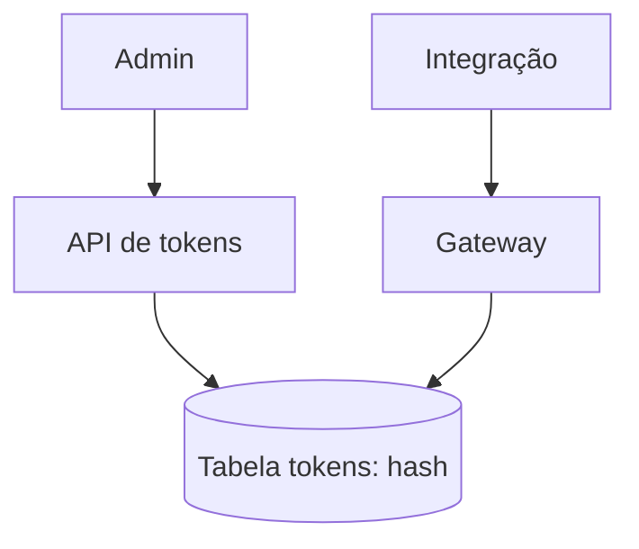

# ACME-142 — Design

**Spec:** `spec.md`

## Visão geral



## Fluxo de revogação

```
admin ──revoga──▶ API ──invalida──▶ cache (TTL 5 s)
                              │
                              └──▶ tabela tokens
```

## Decisões

- **TD-01:** hash com SHA-256 e sal por token (ver AD-001).
